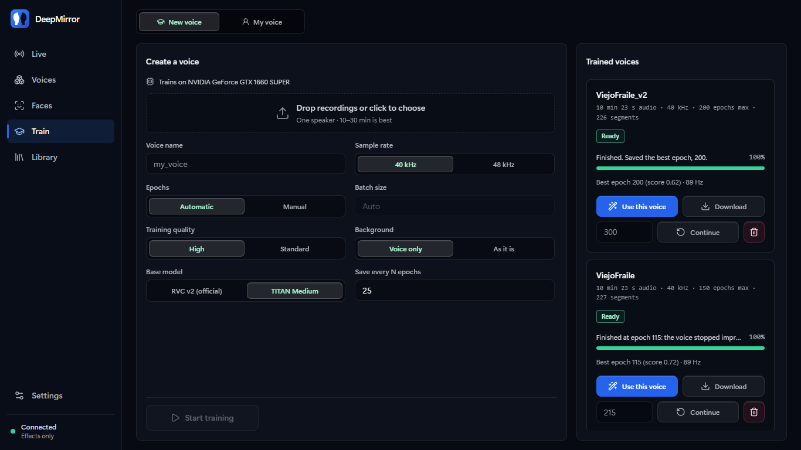

<p align="center">
  
</p>

<h1 align="center">VoxClone</h1>

<p align="center">
  
  
  
  
</p>

Realtime voice changer that runs on your own computer. It converts your voice with RVC
models, live or from a file, and trains new voices from your recordings.

## Quick start

Windows, Linux or macOS. The start script installs [uv](https://docs.astral.sh/uv/), which
brings Python and every dependency; an NVIDIA GPU is used when there is one.

```bash
git clone https://github.com/Sampeerez/VoxClone.git
cd VoxClone
./start.sh          # Windows: double-click start.bat
```

The studio opens at <http://127.0.0.1:8000>. It runs in the background (log in the **Logs**
tab) and stops when you close the page. The first time it asks whether to add a Desktop
shortcut (set `VOXCLONE_SHORTCUTS=yes` or `no` to skip the question). The first
start downloads the shared models (about 400 MB) and checks each one by SHA-256.

Then add a voice in **Models** (an RVC `.pth`, with its `.index` if it has one), press
**Activate**, and press **Start** in **Studio**.

```bash
./start.sh --port 8080 --no-browser    # flags are passed through
./start.sh --keep-alive                # keep running after the page is closed
OVC_TORCH=cpu ./start.sh               # CPU build of PyTorch
```

## What it does

- **Live conversion** of RVC v1/v2 voices, with 1 s of past and 150 ms of future context per chunk
- **Only your voice is converted**: room noise, keyboard and breaths are removed before the model hears them, and nothing of your microphone is ever played unconverted
- **Calls**: a virtual microphone for Discord, Teams or Meet (VB-CABLE on Windows and macOS, PipeWire on Linux)
- **My voice**: read about 90 s of guided lines (Spanish or English) once; every voice is then tuned to your pitch and range when you activate it
- **Pitch**: automatic register matching (voices trained here know their register; a downloaded voice learns it from a short clip of the original), expressiveness, optional pitch correction, formant shift
- **Settings per voice**: each voice keeps its own settings and effects; **Back to automatic** drops them
- **Effects** (13), eight sound presets that never touch the voice's pitch (Radio, Phone, Hall…) plus your own, an A/B switch (<kbd>B</kbd>) and a recorder (<kbd>R</kbd>)
- **Steady under load**: when the computer is too busy to keep up (a browser, a game, a live wallpaper on the same GPU), the stream moves to a longer buffer by itself instead of cutting the voice; the log says which stage took the time
- **Converter** for whole files with any voice in Models (not only the active one), and **Train** to make a voice from 5+ minutes of one speaker, even with music or noise behind it
- **Export** any voice as a `.zip` with its `.pth` and `.index`

## Models used

Chosen by measuring them on this project's own tests, not by date.

| Part | Model | Why |
|---|---|---|
| Content | HuBERT base (RVC v2) | What RVC voices are trained on; another encoder would break them |
| Pitch | RMVPE | Most accurate here: 92% of frames within 50 cents and 0–0.2% octave errors on sung and laughed material, ahead of FCPE (89–91%) and SwiftF0 (86%, 2.5% octave errors). FCPE is the lighter option |
| Noise | DeepFilterNet3, official weights, exported here to one streaming ONNX graph | Least voice distortion (SI-SDR 17–20 dB vs 12 dB for DPDFNet 2026) at 0.07 s of CPU per second of audio |
| Speech detection | Silero VAD v6.2.3 | Latest release |
| Voice separation (training) | Mel-Band RoFormer, vocals model by Kimberley Jensen | Among the best open vocal separators (about 12.6 dB SDR); here music under speech came out 59 dB lower with the voice within 0.5 dB |
| Training base | TITAN Medium | Against the official RVC v2 base, same data and epochs: 7% closer timbre when converting another speaker and fewer notes off in singing (3.2% vs 4.2%) and laughter (8.5% vs 12.1%) |

## Train a voice

In **Train**, drop recordings of one speaker, name the voice and press **Start training**.
The audio is cleaned and sliced, features are extracted on the GPU, the retrieval index is
built, and the voice is fine-tuned from TITAN Medium (RVC v2 tuned on expressive speech; the
official RVC v2 base is also available). A held-out part of the recordings
picks the best epoch, so the voice in **Models** never gets worse if training over-fits.

**Voice only** (on by default) keeps nothing but the voice: when there is music or effects
under it, Mel-Band RoFormer separates the voice first; DeepFilterNet3 then removes the noise
left and Silero VAD drops everything that is not speech. The training status reports how loud
the background was.

**Training quality**: *High* (default) runs about 16 000 optimiser steps with more patience
before stopping early; *Standard* about 7 000. Under 20 minutes of audio each recording is
cropped twice per epoch.

5 minutes of dry speech trains a good voice; 10–30 minutes is better. Training runs in
its own process; live conversion is slower meanwhile.

## How live conversion works

1. Each chunk re-renders the last second of audio plus the new chunk, so the model always has context.
2. The newest 150 ms are rendered but not played, so window edges never reach the output.
3. Consecutive renders are joined at the best-matching offset (SOLA).
   The pitch is tracked on the window itself, never on padding, so a rolled r or a laugh keeps its voicing.
4. DeepFilterNet3 cleans what the model hears; Silero VAD and a periodicity check decide what is voice (a held vowel or a rolled r count as voice).
5. The fast loudness movement of your voice (trills, stops) is put back on the converted voice, which the model alone smooths out.
6. The result is brought to your own level and soft-limited.

## Configuration

Settings can be overridden with environment variables or a `.env` file:

| Variable | Default | Meaning |
|---|---|---|
| `OVC_HOST` / `OVC_PORT` | `127.0.0.1` / `8000` | Listen address (`0.0.0.0` for your LAN) |
| `OVC_DEVICE` | `auto` | `auto`, `cuda`, `mps`, `xpu` or `cpu` |
| `OVC_MODELS_DIR` | `models` | Voices and `.index` files |
| `OVC_CHUNK_SIZE` | `8192` | Live chunk (samples at 48 kHz) |
| `OVC_STREAM_LOOKBACK_SECONDS` | `1.0` | Past context per chunk |
| `OVC_STREAM_LOOKAHEAD_SECONDS` | `0.15` | Future context per chunk (adds latency) |
| `OVC_NOISE_REDUCTION_DB` | `60` | Noise removal (60 = all, 0 = off) |
| `OVC_SILENCE_THRESHOLD_DB` | `-60` | Silence Saver threshold |
| `OVC_RVC_ALLOW_UNSAFE_CHECKPOINTS` | `false` | See Security |
| `OVC_CORS_ORIGINS` | local | Extra origins allowed to use the API |

The full list is in [backend/config.py](backend/config.py).

## Security

The studio listens on loopback only. Cross-origin requests and WebSockets are limited to
`OVC_CORS_ORIGINS`. Voices load with PyTorch's `weights_only` mode; a checkpoint that needs
more is refused unless `OVC_RVC_ALLOW_UNSAFE_CHECKPOINTS=true`.

## Development

```bash
make install          # uv sync + npm ci (TORCH=cuda for CUDA)
make dev-backend      # API with auto-reload on :8000
make dev-frontend     # Vite on :5173
make lint test        # ruff, pyright, eslint, pytest, vitest
```


## Screenshots





## Credits

Started as a fork of [OpenVoiceChanger](https://github.com/sioaeko/OpenVoiceChanger) by
Sioaeko (MIT), since rewritten.

| Component | Use | License |
|---|---|---|
| [RVC](https://github.com/RVC-Project/Retrieval-based-Voice-Conversion) | Conversion network (ported) | MIT |
| [fairseq HuBERT](https://github.com/facebookresearch/fairseq) | Content encoder (ported) | MIT |
| [RMVPE](https://github.com/Dream-High/RMVPE) | Pitch tracker | MIT |
| [DeepFilterNet](https://github.com/Rikorose/DeepFilterNet) | Noise removal (re-implemented) | MIT / Apache-2.0 |
| [Silero VAD](https://github.com/snakers4/silero-vad) | Speech detection | MIT |
| [Mel-Band RoFormer](https://github.com/lucidrains/BS-RoFormer), [vocals weights](https://huggingface.co/KimberleyJSN/melbandroformer) | Voice separation for training (re-implemented) | MIT |
| [TITAN](https://huggingface.co/blaise-tk/TITAN) | Training base | Apache-2.0 |
| [Applio](https://github.com/IAHispano/Applio) | Ideas (pitch correction) | MIT |
| [VB-CABLE](https://vb-audio.com/Cable/) | Virtual microphone, installed by you | Donationware |

## License

MIT, see [LICENSE](LICENSE). DeepFilterNet's notice is in
[backend/audio/deepfilter/LICENSE-DeepFilterNet](backend/audio/deepfilter/LICENSE-DeepFilterNet).
