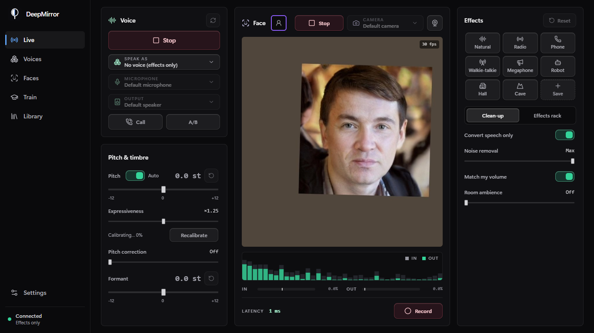
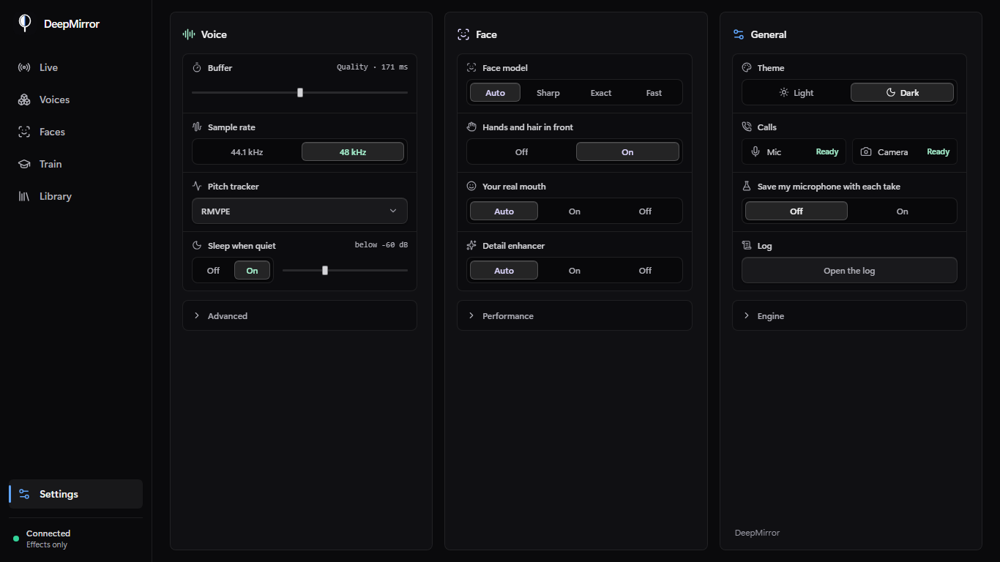
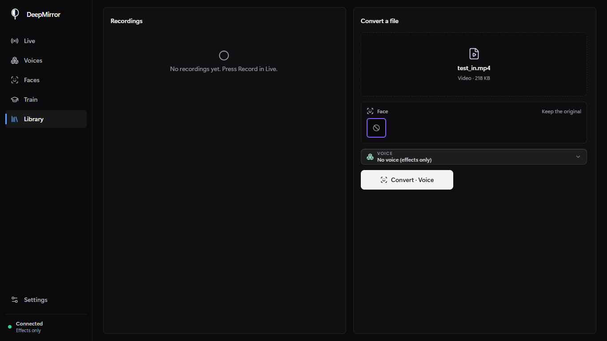
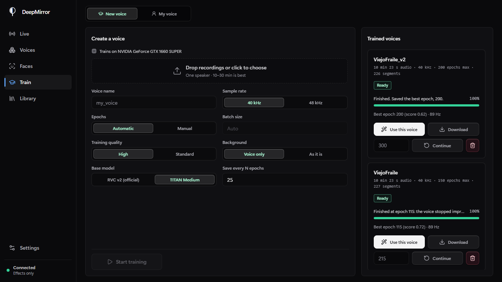
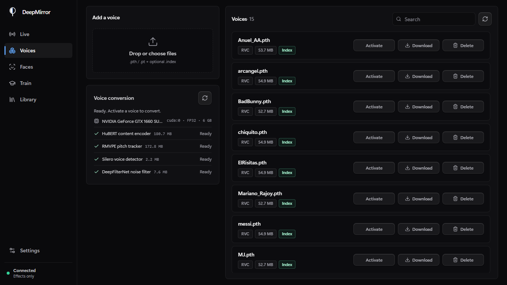

<p align="center">
  
</p>

<h1 align="center">DeepMirror</h1>

<p align="center">
  
  
  
  
</p>

Realtime voice and face cloning that runs on your own computer. It converts your voice with
RVC models and swaps your face on the camera, live (both at once, in sync) or in files, and
trains new voices from your recordings.

## Quick start

Windows, Linux or macOS. The start script installs [uv](https://docs.astral.sh/uv/), which
brings Python and every dependency; an NVIDIA GPU is used when there is one.

```bash
git clone https://github.com/Sampeerez/DeepMirror.git
cd DeepMirror
./start.sh          # Windows: double-click start.bat
```

The studio opens at <http://127.0.0.1:8000> and runs in the terminal (or console window) it was
started from: closing the page leaves it running, **Ctrl+C** there stops it, and every process it
started (the face and head processes) stops with it, even if the window is just closed. The first time it asks whether to add a Desktop
shortcut (set `DEEPMIRROR_SHORTCUTS=yes` or `no` to skip the question). The first
start downloads the shared models (about 400 MB) and checks each one by SHA-256.

Then add a voice in **Voices** (an RVC `.pth`, with its `.index` if it has one), press
**Activate**, and press **Start** in **Studio**.

```bash
./start.sh --port 8080 --no-browser    # flags are passed through
./start.sh --close-with-page           # stop when the studio page is closed
OVC_TORCH=cpu ./start.sh               # CPU build of PyTorch
```

## What it does

Every page is in the sidebar:

| | What it is for |
|---|---|
| **Live** | The voice on the left, the camera and the sound together in the middle, the effects and their presets on the right |
| **Voices** | The RVC voices you have, to add, activate or export |
| **Faces** | The faces you can wear, from 1–12 photos |
| **Train** | A new voice from your recordings, or **My voice**: read 90 s once so every voice fits yours |
| **Library** | The takes recorded in Live, and converting a whole file: an audio file into another voice, or a video with any face from Faces and/or any voice |
| **Settings** | One page: the voice, the face, and the rest (theme, calls, engine, log) |

### Voice

- **Live conversion** of RVC v1/v2 voices, with 1 s of past and 150 ms of future context per chunk
- **Only your voice is converted**: room noise, keyboard and breaths are removed before the model hears them, and nothing of your microphone is ever played unconverted
- **Calls**: a virtual microphone and camera for Discord, Teams or Meet, set up from **Settings › Calls** with one button (VB-CABLE and OBS Virtual Camera on Windows; PipeWire and v4l2loopback on Linux)
- **My voice**: read about 90 s of guided lines (Spanish or English) once; every voice is then tuned to your pitch and range when you activate it
- **Pitch**: automatic register matching (voices trained here know their register; a downloaded voice learns it from a short clip of the original), expressiveness, optional pitch correction, formant shift
- **Settings per voice**: each voice keeps its own settings and effects; **Reset** drops them
- **Effects** (13), eight sound presets that never touch the voice's pitch (Radio, Phone, Hall…) plus your own, an A/B switch (<kbd>B</kbd>) and a recorder (<kbd>R</kbd>)
- **Steady under load**: when the computer is too busy to keep up (a browser, a game, a live wallpaper on the same GPU), the stream moves to a longer buffer by itself instead of cutting the voice; the log says which stage took the time
- **Library** for whole files with any voice in Voices (not only the active one), and **Train** to make a voice from 5+ minutes of one speaker, even with music or noise behind it
- **Export** any voice as a `.zip` with its `.pth` and `.index`

### Face
- **3D head** (Windows + NVIDIA GPU with 6 GB or more): when a face is added, a 3D head with its
  hair, beard and earrings is built once from its best photo (facing the camera, sharp, eyes open,
  mouth shut; a small face is restored first), about a minute, with the photo's clothes, neck and
  background left out. Live, MediaPipe reads your pose and 52 expressions (gaze and blinks too) from
  each camera frame and the head is rendered for exactly that frame, at the size it has on screen,
  with its light matched to yours; your own hair where the new head does not reach is painted over
  with the background. On a GTX 1660 SUPER: 4–6 ms of GPU a frame, 30 fps next to the live voice.
  **It installs itself**: the first start on such a computer downloads it in the background
  (about 7 GB, nothing to compile, progress in Faces and Settings) while Face + hair is used.
- **Whole head**: the person's head, hair, beard and ears, not only the inside of the
  face. The sharpest front-facing photo is animated with your pose and expressions (LivePortrait), so
  hair and skin are the photo's own; the face swap on top keeps your eyes, brows and mouth live. Your
  own hair where the new head does not reach is filled in from the background around it.
- **Face only**: the inside of the face, faster. Its mask follows the parsed outline of the face and
  fades inside it, so there is no halo around it; hands and glasses in front stay in front.
- **In sync with the voice**: every camera frame carries its capture time and is shown when the
  converted voice is heard, so lips and voice line up, in the preview and on the virtual camera.
- **The voice comes first**: the face runs in its own process and uses the GPU only in the gaps the
  voice leaves, so turning video on never cuts the voice. Frames between two face swaps are blended
  and placed with that frame's own face position, so head movement stays exact at camera rate.
- **Virtual camera** for Discord, Meet, Teams or OBS: OBS Virtual Camera, without installing OBS on
  Windows (only its two camera modules, about 450 KB, are fetched from OBS's official release and checked
  by SHA-256); OBS Studio on macOS, v4l2loopback on Linux.
- **Video files** in Library: choose the face (any in Faces, or keep the original) and the voice (any in Voices, or keep the original sound), as one MP4. In whole head mode every frame gets its own render.
- **Fits the computer**: the face swapper is chosen by measuring this GPU next to the live voice, and
  a head render is cut into stages short enough for the voice's GPU gaps. On a GTX 1660 SUPER the output
  stays at 30 fps; the whole head is re-rendered about 1.6 times a second without the voice, and while
  the voice streams non-stop it is re-rendered in its pauses (between renders it moves with your head
  on every frame). A 5 s clip converts in about 90 s in whole head mode, 25 s in face only.

## Models used

Chosen by measuring them on this project's own tests, not by date.

| Part | Model | Why |
|---|---|---|
| Content | HuBERT base (RVC v2) | What RVC voices are trained on; another encoder would break them |
| Pitch | RMVPE | Most accurate here: 92% of frames within 50 cents and 0–0.2% octave errors on sung and laughed material, ahead of FCPE (89–91%) and SwiftF0 (86%, 2.5% octave errors). FCPE is the lighter option |
| Noise | DeepFilterNet3, official weights, exported here to one streaming ONNX graph | Least voice distortion (SI-SDR 17–20 dB vs 12 dB for DPDFNet 2026) at 0.07 s of CPU per second of audio |
| Speech detection | Silero VAD v6.2.3 | Latest release |
| Voice separation (training) | Mel-Band RoFormer, vocals model by Kimberley Jensen | Among the best open vocal separators (about 12.6 dB SDR); here music under speech came out 59 dB lower with the voice within 0.5 dB |
| Training base | TITAN Medium | Against the official RVC v2 base, same data and epochs: 7% closer timbre when converting another speaker and fewer notes off in singing (3.2% vs 4.2%) and laughter (8.5% vs 12.1%) |

### Face clone

The models download the first time you open **Faces** (about 2.4 GB), from FaceFusion's
releases and LivePortrait's, and run with ONNX Runtime (CUDA, DirectML or CPU) and PyTorch (the head).

| Part | Model | Why |
|---|---|---|
| Detection | SCRFD 2.5G | 5 ms per frame on the CPU around the tracked face, leaving the GPU to the voice and the swap |
| Identity | ArcFace w600k R50 | What every swapper is conditioned on; averaged over several photos for a steadier face |
| Swap | HyperSwap 1b (256 px), inswapper (128 px), GHOST (256 px) | Compared on generated faces: inswapper keeps identity best (ArcFace 0.80–0.90), HyperSwap is the sharpest and masks hands and hair itself, GHOST is the fastest (29 ms). SimSwap kept identity worst (0.58–0.66) and was left out. HyperSwap is stored in fp32 here: its fp16 weights gave NaN on CUDA without tensor cores, and fp32 runs in 43 ms instead of 117 |
| Occlusion | XSeg | Hands and objects in front of the face, for swappers without their own mask |
| Detail | GPEN-BFR 256 | Only on close faces when the GPU has room: it costs a little identity |
| Whole head | LivePortrait (human), run here in PyTorch fp32 in 33 stages of at most ~33 ms | No swap model changes hair or the head's outline (FaceFusion, Deep-Live-Cam, HyperSwap, inswapper, GHOST all replace the inside of the face); animating the photo itself does. fp16 is slower on this GPU and gave NaN |
| 3D head | LAM-20K (Large Avatar Model, SIGGRAPH 2025), driven by MediaPipe Face Landmarker | One photo to an animatable 3D Gaussian head with its hair in ~1 minute on this GPU (1.8 GB of GPU memory at most, so it fits next to the studio); renders a frame in 4–6 ms, so every frame gets its own head. Runs in its own Python 3.10 environment (`models/lam`, ~7 GB), with its CUDA libraries prebuilt for GTX 10 to RTX 40 (RTX 50 through PTX) |
| Parsing | BiSeNet (ResNet-34) | Hair, ears and neck of the worn head, and the speaker's own hair to fill in |

Also reviewed: Deep-Live-Cam and LiveFaceCam (inswapper/HyperSwap with a mouth mask; the real-mouth
option here comes from them), DeepFaceLive (its HEAD models do include hair, but each needs a model
trained per face for days), FasterLivePortrait (30+ fps only with TensorRT on an RTX 3090; ONNX
Runtime has no 5-D grid_sample on CUDA, which is why the head runs in PyTorch here).

## Train a voice

In **Train**, drop recordings of one speaker, name the voice and press **Start training**.
The audio is cleaned and sliced, features are extracted on the GPU, the retrieval index is
built, and the voice is fine-tuned from TITAN Medium (RVC v2 tuned on expressive speech; the
official RVC v2 base is also available). A held-out part of the recordings
picks the best epoch, so the voice in **Voices** never gets worse if training over-fits.

**Voice only** (on by default) keeps nothing but the voice: when there is music or effects
under it, Mel-Band RoFormer separates the voice first; DeepFilterNet3 then removes the noise
left and Silero VAD drops everything that is not speech. The training status reports how loud
the background was.

**Training quality**: *High* (default) runs about 16 000 optimiser steps with more patience
before stopping early; *Standard* about 7 000. Under 20 minutes of audio each recording is
cropped twice per epoch.

5 minutes of dry speech trains a good voice; 10–30 minutes is better. Training runs in
its own process; live conversion is slower meanwhile.

## How live conversion works

1. Each chunk re-renders the last second of audio plus the new chunk, so the model always has context.
2. The newest 150 ms are rendered but not played, so window edges never reach the output.
3. Consecutive renders are joined at the best-matching offset (SOLA).
   The pitch is tracked on the window itself, never on padding, so a rolled r or a laugh keeps its voicing.
4. DeepFilterNet3 cleans what the model hears; Silero VAD and a periodicity check decide what is voice (a held vowel or a rolled r count as voice).
5. Where you roll an r, the fast loudness movement of your voice is put back on the converted voice (the model alone smooths a trill into a vowel); everywhere else the model's own envelope stays, which sounds closer to the voice.
6. The result is brought to your own level and soft-limited.

## Configuration

Settings can be overridden with environment variables or a `.env` file:

| Variable | Default | Meaning |
|---|---|---|
| `OVC_HOST` / `OVC_PORT` | `127.0.0.1` / `8000` | Listen address (`0.0.0.0` for your LAN) |
| `OVC_DEVICE` | `auto` | `auto`, `cuda`, `mps`, `xpu` or `cpu` |
| `OVC_MODELS_DIR` | `models` | Voices and `.index` files |
| `OVC_CHUNK_SIZE` | `8192` | Live chunk (samples at 48 kHz) |
| `OVC_STREAM_LOOKBACK_SECONDS` | `1.0` | Past context per chunk |
| `OVC_STREAM_LOOKAHEAD_SECONDS` | `0.15` | Future context per chunk (adds latency) |
| `OVC_NOISE_REDUCTION_DB` | `60` | Noise removal (60 = all, 0 = off) |
| `OVC_SILENCE_THRESHOLD_DB` | `-60` | Silence Saver threshold |
| `OVC_RVC_ALLOW_UNSAFE_CHECKPOINTS` | `false` | See Security |
| `OVC_CORS_ORIGINS` | local | Extra origins allowed to use the API |
| `OVC_HEAD3D` | on | `off`: never install the 3D head by itself (`uv run python scripts/setup_head3d.py` installs it by hand) |

The full list is in [backend/config.py](backend/config.py).

## Security

The studio listens on loopback only. Cross-origin requests and WebSockets are limited to
`OVC_CORS_ORIGINS`. Voices load with PyTorch's `weights_only` mode; a checkpoint that needs
more is refused unless `OVC_RVC_ALLOW_UNSAFE_CHECKPOINTS=true`.

## Development

```bash
make install          # uv sync + npm ci (TORCH=cuda for CUDA)
make dev-backend      # API with auto-reload on :8000
make dev-frontend     # Vite on :5173
make lint test        # ruff, pyright, eslint, pytest, vitest
```

The 3D head's CUDA libraries (pytorch3d, diff-gaussian-rasterization, nvdiffrast's plugin) are
compiled once by maintainers with `scripts/build_head3d_wheels.py` (Visual Studio 2019 Build Tools
and CUDA 11.8) and published as the `head3d-deps-1` release; `scripts/setup_head3d.py` pins their
SHA-256.


## Screenshots







## Credits

Started as a fork of [OpenVoiceChanger](https://github.com/sioaeko/OpenVoiceChanger) by
Sioaeko (MIT), since rewritten.

| Component | Use | License |
|---|---|---|
| [RVC](https://github.com/RVC-Project/Retrieval-based-Voice-Conversion) | Conversion network (ported) | MIT |
| [fairseq HuBERT](https://github.com/facebookresearch/fairseq) | Content encoder (ported) | MIT |
| [RMVPE](https://github.com/Dream-High/RMVPE) | Pitch tracker | MIT |
| [DeepFilterNet](https://github.com/Rikorose/DeepFilterNet) | Noise removal (re-implemented) | MIT / Apache-2.0 |
| [Silero VAD](https://github.com/snakers4/silero-vad) | Speech detection | MIT |
| [Mel-Band RoFormer](https://github.com/lucidrains/BS-RoFormer), [vocals weights](https://huggingface.co/KimberleyJSN/melbandroformer) | Voice separation for training (re-implemented) | MIT |
| [TITAN](https://huggingface.co/blaise-tk/TITAN) | Training base | Apache-2.0 |
| [Applio](https://github.com/IAHispano/Applio) | Ideas (pitch correction) | MIT |
| [VB-CABLE](https://vb-audio.com/Cable/) | Virtual microphone, installed by you | Donationware |
| [FaceFusion](https://github.com/facefusion/facefusion) model releases | Face models (HyperSwap, XSeg, GPEN, converters), downloaded on first use | Models: non-commercial |
| [InsightFace](https://github.com/deepinsight/insightface) | inswapper, ArcFace, SCRFD, downloaded on first use | Code MIT, models non-commercial research only |
| [Deep-Live-Cam](https://github.com/hacksider/Deep-Live-Cam), [LiveFaceCam](https://github.com/huzaifa525/LiveFaceCam) | Ideas (mouth mask) | AGPL-3.0 |
| [LivePortrait](https://github.com/KlingTeam/LivePortrait) | Whole head: its networks (vendored in `backend/video/liveportrait`) and weights, downloaded on first use | MIT |
| [LAM](https://github.com/aigc3d/LAM) | 3D head: built and rendered in its own environment, installed by itself on a suitable computer | Code Apache-2.0, weights CC BY-NC 4.0 |
| [FLAME](https://flame.is.tue.mpg.de/) | The head model LAM animates (in LAM's assets) | MPI FLAME licence, non-commercial |
| [MediaPipe](https://github.com/google-ai-edge/mediapipe) | 3D head: face landmarks and blendshapes from the camera | Apache-2.0 |
| [BiSeNet face parser](https://huggingface.co/facefusion/models-3.0.0) | Face and hair regions, from FaceFusion's release | MIT |
| [OBS Studio](https://obsproject.com/) virtual camera module, via [pyvirtualcam](https://github.com/letmaik/pyvirtualcam) | Virtual camera, fetched and registered on request | GPL-2.0 / GPL-2.0 |

## License

MIT, see [LICENSE](LICENSE). DeepFilterNet's notice is in
[backend/audio/deepfilter/LICENSE-DeepFilterNet](backend/audio/deepfilter/LICENSE-DeepFilterNet).

The face models are not part of this repository and carry their own licences: InsightFace's and
FaceFusion's are for non-commercial use, as are LAM's weights and FLAME (3D head). Use only faces and voices you have permission to use.
