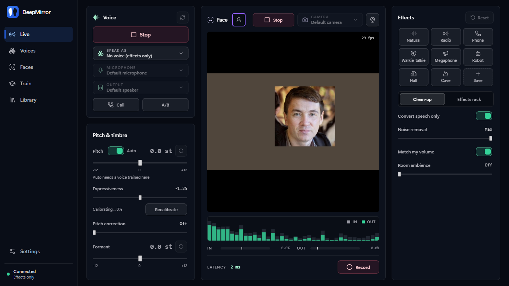
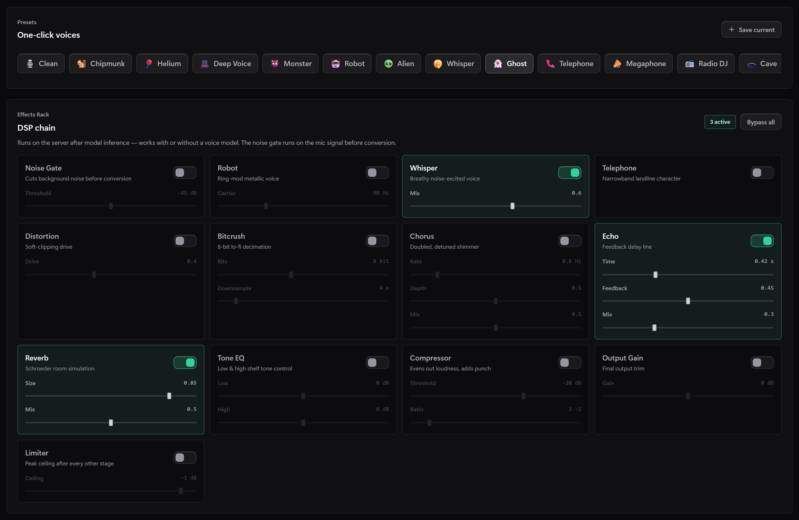
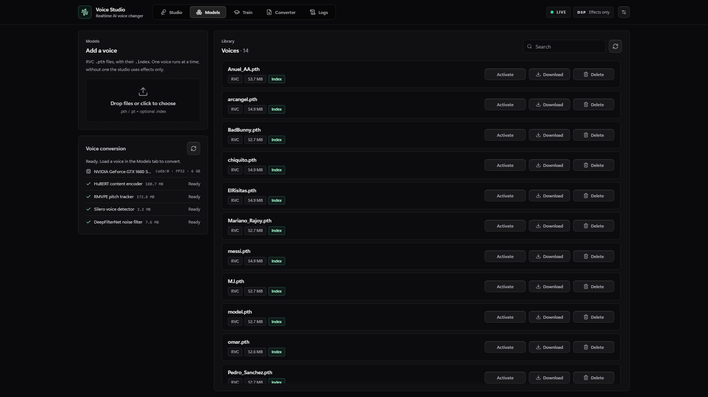
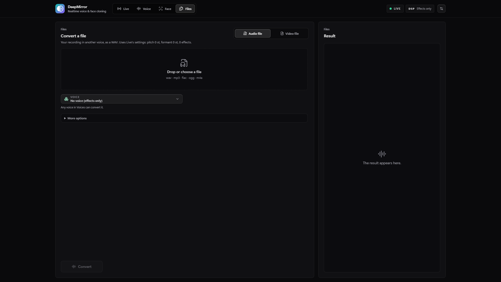
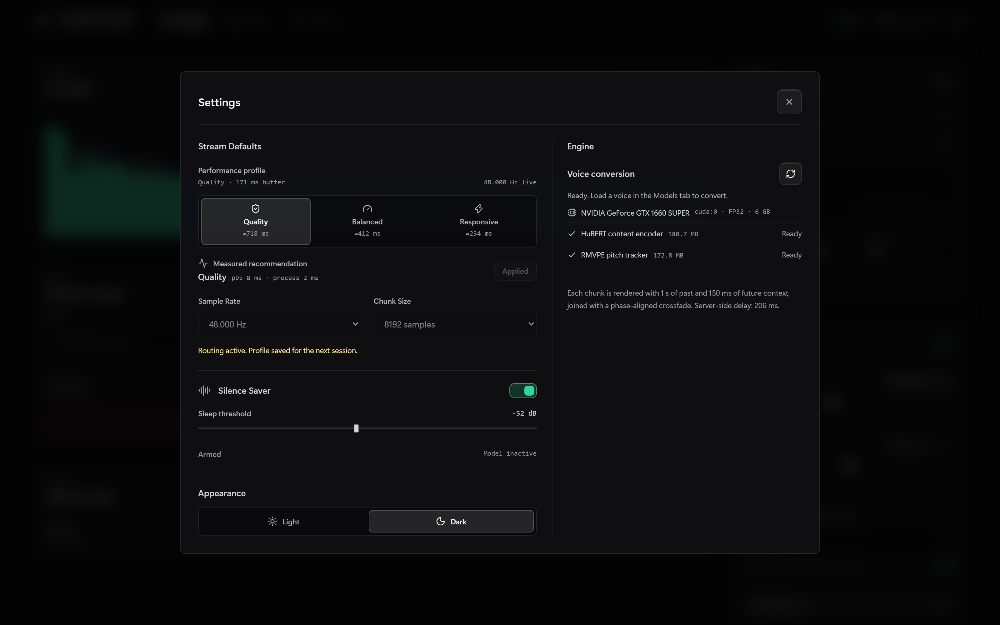

# OpenVoiceChanger

<p align="center">
  
  
  
  
  
  
</p>

<p align="center">
  Realtime and offline RVC voice conversion studio that runs locally in your browser.<br/>
  One command to start, no manual Python setup, quality-first streaming.
</p>

<p align="center">
  <a href="#quick-start">Quick Start</a> •
  <a href="#train-your-own-voice">Train a voice</a> •
  <a href="#how-the-realtime-engine-works">Realtime engine</a> •
  <a href="#configuration">Configuration</a> •
  <a href="#development">Development</a> •
  <a href="README_KR.md">한국어</a> •
  <a href="README_JP.md">日本語</a>
</p>

---

## Quick Start

**Requirements:** Windows, Linux or macOS. Nothing else: the start script installs
[uv](https://docs.astral.sh/uv/), which downloads Python and every dependency on its own.
An NVIDIA GPU is used automatically when present; Apple Silicon uses MPS.

```bash
git clone https://github.com/sioaeko/OpenVoiceChanger.git
cd OpenVoiceChanger
./start.sh          # Windows: double-click start.bat
```

The studio opens in your browser at <http://127.0.0.1:8000>. There is no console window
to keep open: the server runs in the background, its log is in the **Logs** tab, and
**closing the studio page stops it** (a reload does not; a training run in progress
finishes on its own). On Windows the first run also adds an **OpenVoiceChanger** shortcut
to the Desktop and Start menu that starts it with no window at all; on Linux an app-menu
entry is added. On the first run the shared model assets (HuBERT, ~190 MB, RMVPE,
~180 MB, and the Silero voice detector, 2 MB) are downloaded and verified by SHA-256.
The web UI is built automatically with a bundled Node.js.

Then open **Models**, drop in an RVC `.pth` voice (and its `.index` if it has one),
press **Activate**, and start the voice changer in **Studio**.

Useful options:

```bash
./start.sh --port 8080 --no-browser     # any CLI flag is passed through
./start.sh --keep-alive                 # keep running after the page is closed
./start.sh --foreground                 # (Linux/macOS) stay attached to this terminal
OVC_TORCH=cpu ./start.sh                # force the CPU build of PyTorch (set OVC_TORCH=cpu on Windows)
./start.sh --device cpu                 # keep the GPU build but run inference on the CPU
```

## Features

### Realtime studio
- RVC v1/v2 voice conversion (with and without pitch) streamed over a binary WebSocket and an AudioWorklet
- Quality-first streaming: every chunk is re-rendered with **1 s of past and 150 ms of future context** and joined with a phase-aligned (SOLA) crossfade; see [How the realtime engine works](#how-the-realtime-engine-works)
- Three profiles in Settings with an estimated end-to-end latency: **Quality** (~700 ms), **Balanced** (~400 ms), **Responsive** (~250 ms)
- Exact nearest-neighbour **index retrieval** on the GPU for closer timbre than classic RVC's approximate search
- Pitch and formant shifting, RVC controls (index rate, filter radius, RMS mix, protect, Crepe hop) and **13 pitch trackers**: PM, Harvest, DIO, Crepe/Mangio-Crepe (full and tiny), RMVPE, FCPE and offline hybrids. RMVPE is chosen automatically on a GPU
- **13-effect DSP rack**: noise gate, robot, whisper, telephone, distortion, bitcrush, chorus, echo, reverb, EQ, compressor, output gain, limiter
- **16 built-in presets** plus your own, saving the whole Voice Lab state
- **Calls (Discord, Teams, Meet…)**: call mode sends the converted voice to a virtual microphone and you stop hearing yourself (optional headphone monitor). On Windows and macOS the studio downloads the official VB-CABLE package by VB-Audio (free donationware) and opens its installer for you; on Linux it creates a PipeWire/PulseAudio microphone with nothing to install. Then pick "CABLE Output" (or "OpenVoiceChanger Microphone") as the microphone in the call app
- **Natural, melodic voice**: Expressiveness (default ×1.25) widens your rises and falls in pitch so the voice is less monotone, leaving the fine detail alone; voices trained in the studio use their own melodic range. Your pitch centre and range are learnt in the first seconds you speak and remembered for the next session (Recalibrate any time). Laughs, humming and other pitched sounds are converted as voice
- **No invented sounds on quiet speech**: voicing must be audible and periodic at its own pitch, so a soft "no, no" does not turn fricatives or room noise into sung vowels, and the converted voice can never be louder than what you actually said around speech
- **Logs** tab: the server's output live (filter, search, pause, copy, download) and each training run's log
- **Speech-only conversion**: a neural voice detector (Silero VAD) converts only speech. Room noise, breaths and clicks are never sent through the voice model; the room stays audible, unconverted and time-aligned (Room ambience slider)
- **Noise reduction** for what the model hears, learnt from the pauses, gentle while you speak so soft word endings survive
- **Match my volume**: the converted voice comes out as loud as you speak, whatever the model's own level, with a soft limiter against clipping
- **Silence Saver** pauses inference when nobody speaks without cutting the end of the last word, wakes on a single quiet syllable and keeps listening while asleep, so the next word starts with real context
- Switching voices is seamless: the previous voice keeps converting until the new one is fully loaded and warm, and only then is it shown as active
- **Auto pitch**: voices trained in the studio store their pitch range, and the live stream moves your register onto the voice's (for example about +12 semitones from a low voice to a high one) while keeping your intonation. Pitch and formant start at 0, and every RVC control starts at its recommended value until you change it
- Spectrum, meters, latency history, server timing (model/DSP/network) and stream diagnostics
- Output recorder (<kbd>R</kbd>) with a take library stored in the browser; <kbd>B</kbd> toggles an A/B bypass
- Model-free DSP mode: pitch shifting and effects with no voice loaded

### Voice training
- **Train** tab: upload recordings of one speaker and get a ready-to-use voice (`.pth` + `.index`), trained on your GPU; see [Train your own voice](#train-your-own-voice)

### Offline converter
- Render a whole file (WAV, FLAC, OGG, MP3, ...) through the active voice, the Voice Lab settings and the effect rack, with RVC's full padding and quiet-point splitting for maximum quality

### Models
- Drag-and-drop upload of `.pth` voices and `.index` files (matched by name, or the only index in the folder)
- Voice details: RVC version, sample rate, pitch support, index size, device, warm-up render time

## Screenshots

### Studio


### Presets & effects rack


### Models


### Converter


### Settings


## Train your own voice

Open the **Train** tab, drop recordings of one speaker, name the voice and press **Start
training**. Everything else is automatic:

1. **Base models.** The official RVC v2 pretrained generator and discriminator (40 or 48 kHz) are downloaded once and verified by SHA-256. Fine-tuning from them is what makes a few minutes of audio enough.
2. **Data preparation.** Audio is converted to mono, high-pass filtered and brought to a consistent speech level, then cut at pauses, split into overlapping 3.7 s segments and softly peak-normalised. Clipped segments are dropped. The job reports how much speech it found, clipping, background noise and the share of voiced speech, with advice when the material is weak.
3. **Features.** HuBERT content features and RMVPE pitch are extracted on the GPU.
4. **Index.** The retrieval index is built straight away, in the standard faiss format, so it also works in other RVC tools.
5. **Automatic plan.** Epochs and batch size come from the amount of speech and the free GPU memory: the batch fits the GPU but stays small enough for about a dozen steps per epoch, and the epoch budget targets about 7,000 optimiser steps (150–1,000 epochs). Under 10 minutes of audio every segment gives two random crops per epoch. Precision is chosen per GPU: bf16 on RTX 30 and newer, FP16 where it is reliable, FP32 on GTX 16xx and older, where FP16 is slower and unstable.
6. **Best epoch, not last epoch.** About 8% of the segments are held out. Every few epochs they are rendered through the same path live conversion uses and compared with the real voice. The voice in **Models** is always the best-scoring epoch, so it never gets worse if training starts to over-fit, and training stops by itself once the score stops improving. **Stop and save** keeps the best voice, and **Continue training** resumes later, even after a restart.
7. **Pitch range.** The voice's median pitch is saved in the `.pth` (other RVC tools ignore it) and drives **Auto pitch**.

**Recordings:** 5 minutes of clean, dry speech from one person trains a good voice; 10–30
minutes captures more of the pitch range and sounds, and 1 minute is the minimum. Avoid
music, reverb, noise and other voices. Vary intonation: questions, calm and lively speech.
Leave **Epochs** on *Automatic*; a manual value is an upper limit and the best epoch is still
the one kept.

Training runs in its own process, so the studio keeps working. Live conversion is slower
while the GPU trains. On a GTX 1660 SUPER one epoch over 6 minutes of speech takes about
35 s; RTX cards are several times faster. Without a GPU, training works but is very slow.

## How the realtime engine works

RVC models are trained on whole utterances. Fed short chunks naively, they lose timbre and
intonation at every chunk boundary and the seams click. For every chunk, the engine:

1. **Re-renders a rolling window.** The window holds the last second of input plus the new chunk, so HuBERT, the pitch tracker and the synthesizer always have real left context.
2. **Holds back a lookahead.** The newest 150 ms of each render are not emitted yet. Every sample that reaches your speakers was rendered with real audio after it, so the model's edge effects never reach the output. This is a fixed 150 ms of extra latency.
3. **Joins renders with SOLA.** The tail held back from the previous render is matched against the new one within ±6 ms, then crossfaded at the best-correlated offset. Windows join without clicks or phasing.
4. **Resamples with soxr.** soxr is a band-limited resampler, unlike FFT resampling, which wraps the end of each window into its start.
5. **Applies a shift-invariant loudness envelope.** The RMS mix envelope is computed with a sliding window, so overlapping renders agree on the level they apply.
6. **Converts speech only.** Silero VAD marks speech every 32 ms, with pre-roll and hang-over so attacks and endings are kept, and a minimum of confident frames so a breath is not taken for speech. Outside speech the output is your room, unconverted, at the ambience level; under speech, the noise the reducer removed plays back too, so there are no holes in the room sound.
7. **Matches your level.** The converted voice is measured against your voice over the same speech frames and a slow gain (about 0.5 s) brings it to your loudness.

Only the end of each window is vocoded (the content encoder and flow still see the whole
window), and on CPU the vocoder runs on ONNX Runtime. On a GTX 1660 SUPER the Quality
profile renders a 171 ms chunk in about 85 ms with RMVPE and index retrieval. On a
12th-gen Core i7 without a GPU, the Light (CPU) profile renders a 341 ms chunk in about
315 ms. Its output keeps about 95% of the spectral similarity of a
full offline render; the ceiling for this metric is two offline renders with different
random seeds.

The inference code is a self-contained, typed port of the MIT-licensed
[RVC](https://github.com/RVC-Project/Retrieval-based-Voice-Conversion) synthesizer and
RMVPE, plus fairseq's HuBERT encoder, with no dependency on fairseq, faiss or librosa. Its
output was checked against the original implementation, and the tests keep checking it
when the reference files are present.

## Configuration

Every setting can be overridden with an environment variable or a `.env` file in the
project folder. Common ones:

| Variable | Default | Meaning |
|---|---|---|
| `OVC_HOST` / `OVC_PORT` | `127.0.0.1` / `8000` | Listen address. `0.0.0.0` exposes the studio on your LAN |
| `OVC_DEVICE` | `auto` | `auto`, `cuda`, `mps`, `xpu` or `cpu` |
| `OVC_MODELS_DIR` | `models` | Where voices and `.index` files live |
| `OVC_CHUNK_SIZE` | `8192` | Default live chunk (samples at 48 kHz) |
| `OVC_STREAM_LOOKBACK_SECONDS` | `1.0` | Past context re-rendered with every chunk |
| `OVC_STREAM_LOOKAHEAD_SECONDS` | `0.15` | Future context per chunk (adds this much latency) |
| `OVC_STREAM_PAD_SECONDS` | `0.1` | Edge padding of each streaming window |
| `OVC_INDEX_EXACT_SEARCH` | `true` | `false` reproduces classic RVC's approximate index search |
| `OVC_DEFAULT_INDEX_RATE` / `OVC_DEFAULT_PROTECT` / ... | RVC defaults | Starting values of the Voice Lab controls |
| `OVC_SILENCE_THRESHOLD_DB` | `-60` | Level (loudest 10 ms of a chunk) below which Silence Saver pauses inference |
| `OVC_RESTORE_LAST_VOICE` | `true` | Load the voice that was active when the studio last closed |
| `OVC_VOICE_ISOLATION` | `true` | Convert speech only; noise and breaths play as unconverted ambience |
| `OVC_NOISE_REDUCTION_DB` | `12` | Room noise removed from what the model hears (0 = off) |
| `OVC_AMBIENT_DB` | `-6` | Level of the unconverted room around the voice (-60 = off) |
| `OVC_MATCH_LOUDNESS` | `true` | Bring the converted voice to the speaker's own level |
| `OVC_RVC_ALLOW_UNSAFE_CHECKPOINTS` | `false` | See [Security](#security) |
| `OVC_CORS_ORIGINS` | local origins | Extra origins allowed to use the API |

See [backend/config.py](backend/config.py) for the full list.

## Security

- **Network:** the studio listens on loopback by default. Same-origin requests are always allowed. Cross-origin HTTP and WebSocket access is limited to `OVC_CORS_ORIGINS`, and the WebSocket checks the `Origin` header because browsers do not apply the same-origin policy to WebSockets. Anyone who can reach a LAN-exposed studio can upload and run models.
- **Checkpoints:** `.pth` files are Python pickles, and unpickling one can run code. Voices load with PyTorch's `weights_only` mode, and a checkpoint that needs more is refused unless you set `OVC_RVC_ALLOW_UNSAFE_CHECKPOINTS=true`. The HuBERT asset is accepted only with its published SHA-256, and only through a restricted unpickler.

## Development

```bash
make install            # uv sync (CPU torch; TORCH=cuda for CUDA) + npm ci
make dev-backend        # API with auto-reload on :8000
make dev-frontend       # Vite dev server on :5173 (proxies /api and /ws)
make lint test          # ruff + pyright + eslint, pytest + vitest
make release            # build the UI and package a release archive
```

### Project structure

```
backend/
  __main__.py        CLI (`openvoicechanger`), UI build check, browser launch
  app.py             FastAPI factory and lifespan
  config.py          All settings (OVC_* environment variables)
  assets.py          HuBERT / RMVPE download and verification
  model_manager.py   Voice library and the active voice
  presets.py         Built-in and user presets
  security.py        Origin checks for CORS and the WebSocket
  api/               HTTP + WebSocket endpoints (models, presets, convert, stream, training, system)
  audio/             Wire protocol, soxr resampling, realtime streaming (SOLA), DSP effects
  inference/         HuBERT, RVC synthesizers, RMVPE, pitch trackers, index retrieval, pipeline
  training/          Dataset preparation, index builder, GAN training loop, job manager and worker process
frontend/            React 19 + Vite 8 + Tailwind 4 studio
tests/               pytest suite (API, streaming, DSP, inference equivalence)
start.sh, start.bat  One-command launchers
```

### Wire protocol

The browser sends a JSON config (`sample_rate`, `chunk_size`, and optionally
`lookback_seconds` / `lookahead_seconds`), then binary frames. Each frame is an 8-byte
header followed by float32 PCM: a `uint32` sequence number and a reserved `uint32`. The
server answers every frame with a converted frame of the same length. Its reserved field
carries the server time in 1/100 ms. JSON messages update settings at any time, and
the server sends a `status` message about once a second.

## License

MIT. The inference networks are ports of MIT-licensed RVC code and of fairseq's HuBERT
(MIT).
